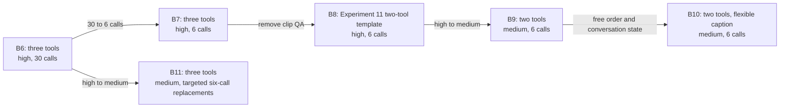

# Stage B v2: modality merge on selected Val125

## Outline

- [Experiment path](#experiment-path)
- [Results](#results)
- [Follow-up path: B7–B11](#follow-up-path-b7b11)
- [Fixed controls](#fixed-controls)
- [Prompt and media provenance](#prompt-and-media-provenance)
- [Running and resuming](#running-and-resuming)
- [One-question smoke check](#one-question-smoke-check)
- [Old results and smoke outputs to review before manual deletion](#old-results-and-smoke-outputs-to-review-before-manual-deletion)
- [Interpretation limits](#interpretation-limits)

## Experiment path

This revision has eight runs: B0–B6 plus B5-flex. It moves OmniAgent's
[−A−E / C+Q+M selected Val125 result](/mnt/ceph_rbd/data/avqa_project/daily_omni/OmniAgent_tool_ablation_selectedVal125/minus_a_e/output_test.jsonl)
into the DSPy Free-ReAct implementation and then changes sampling, prompt,
caption tool, order/placement, QA tools, and metadata visibility. The source
OmniAgent result was 100/125 (80.0%) with 7.848 tool calls per question.
Here −A−E means removal of the ASR and audio-event groups; the remaining
C+Q+M tools are `audio_global_caption`, `audio_qa`,
`video_global_qa`, `video_clip_qa`, and `video_metadata`.

| ID | Change from prior run | Caption | QA | Planner-visible M | First call / caption placement |
| --- | --- | --- | --- | --- | --- |
| B0 | Move OmniAgent −A−E into DSPy with original workflow and specialized tools | `audio_global_caption` | Specialized Q | Yes | Free / conversation state |
| B1 | Gemini sampling only: 0.6/0.95/20 → 0/1/0 | Same | Same | Yes | Same |
| B2 | Replace the whole OmniAgent workflow with the actual Experiment 11 Basic Tools workflow, adapted for C+Q+M and free order | Same | Same | Yes | Free / conversation state |
| B3 | Replace audio-only caption with `ask_caption` | `ask_caption` | Specialized Q | Yes | Free / conversation state |
| B4 | Require first-round `ask_caption` and move its full observation into the task | `ask_caption` | Specialized Q | Yes | Required first / task |
| B5 | Replace specialized Q with global and clip omni QA | `ask_caption` | `ask_perception` + `omni_clip_perception` | Yes | Required first / task |
| B5-flex | Same tools as B5, but remove the caption-first bundle: first call is free and caption stays in conversation state | Same | Same | Yes | Free / conversation state |
| B6 | Hide `video_metadata` from the planner; retain clip QA | `ask_caption` | `ask_perception` + `omni_clip_perception` | No | Required first / task |

Specialized Q is always `audio_qa + video_global_qa + video_clip_qa`.
B2→B3 isolates omni caption; B4→B5 isolates omni QA. B3→B4 is one
combined design choice (first caption plus task placement). B5/B5-flex tests
that same combined design choice after QA has been merged. The six-call,
two-tool, reasoning-effort, and flexible-order comparisons continue in
B7–B10 below.

## Results

All 24 runs covered the same 125 questions. Each output contained 125 rows;
2,998/3,000 final answers were parseable and ended naturally. The other two
ended with upstream API errors, and no question reached the 30-call budget.
The source JSONL for each run is linked in the individual repeat tables.
Input/output tokens and cost below include one attributed Gemini generation
for **each** cached caption invocation, alongside the persisted planner and
live-tool usage. The caption text subsequently read by the planner is already
counted in planner input and is not added twice. Costs use the same recorded
o3/Gemini rates as the experiment metrics. For 77 selected-Val125 audio-caption
cache entries whose legacy source traces omitted token usage, input tokens are
estimated from same-duration entries generated in that cache (30 s: median
1,030; 60 s: median 1,780); output tokens use the observed output-token/character
ratio. Gemini calls without modality details use the observed audio fraction
within the same caption type and duration. These are generation-equivalent
per-call estimates, not the historical bill for building a shared cache.

Latency remains the **measured cache-read rollout latency**, adjusted for
retries. The older caption sources do not provide comparable per-call
generation timings, so an uncached end-to-end latency cannot be reconstructed
without an additional timed experiment. The
[accounting audit](artifacts/figures/modality_merge_ablation/cache_inclusive_audit.json)
retains the exact source path, cache-call count, and estimated-usage count for
each run.

The [three-panel accuracy/efficiency figure](artifacts/figures/modality_merge_ablation/ablation_accuracy_efficiency_three_panel_cache_inclusive.pdf)
uses the three-run means below. It shows B0–B11, omitting the B5-flex control.

The caption-generation contribution added to the live-call metrics is shown
separately here for B0–B11 and B5-flex. Calls and usage-estimated counts are
totals over three repeats; token and cost additions are averages per question
across the three repeats. B11's full results appear in the follow-up table.

| ID | Cached caption calls | Calls with estimated source usage | Added input tokens / question | Added output tokens / question | Added cost / question |
| --- | ---: | ---: | ---: | ---: | ---: |
| B0 | 270 | 212 | 995 | 56 | $0.00112 |
| B1 | 274 | 215 | 1,019 | 57 | $0.00114 |
| B2 | 144 | 123 | 512 | 31 | $0.00058 |
| B3 | 336 | 0 | 5,152 | 622 | $0.00343 |
| B4 | 405 | 0 | 6,020 | 734 | $0.00403 |
| B5 | 387 | 0 | 5,884 | 721 | $0.00394 |
| B5-flex | 212 | 0 | 3,154 | 383 | $0.00211 |
| B6 | 389 | 0 | 5,884 | 722 | $0.00395 |
| B7 | 374 | 0 | 5,756 | 707 | $0.00386 |
| B8 | 375 | 0 | 5,771 | 707 | $0.00387 |
| B9 | 375 | 0 | 5,771 | 707 | $0.00387 |
| B10 | 338 | 0 | 5,241 | 642 | $0.00351 |
| B11 | 375 | 0 | 5,771 | 707 | $0.00387 |

### Three-run mean and standard deviation

Values are the mean ± **sample standard deviation** across repeat1, repeat2,
and repeat3 (`n=3`). Token, cost, latency, and calls/question values are first
averaged over the 125 questions within each repeat and then summarized across
the three repeats. Accuracy variation is likewise variation across repeats,
not a binomial standard error over a pooled 375-question sample.

| ID | Change from prior run | Accuracy | Calls / question | Input tokens / question | Output tokens / question | Estimated cost / question | Measured latency / question |
| --- | --- | ---: | ---: | ---: | ---: | ---: | ---: |
| B0 | Move OmniAgent −A−E into DSPy with its original workflow and specialized C+Q+M | 75.47% ± 1.22% | 4.309 ± 0.205 | 19,783 ± 1,236 | 6,414 ± 293 | $0.08046 ± $0.00546 | 64.73 ± 8.64 s |
| B1 | Gemini sampling only: 0.6/0.95/20 → 0/1/0 | 76.00% ± 1.60% | 4.232 ± 0.081 | 19,771 ± 153 | 6,261 ± 329 | $0.07797 ± $0.00227 | 61.84 ± 7.02 s |
| B2 | Replace the OmniAgent workflow with the Experiment 11 workflow adapted to specialized C+Q+M | 72.27% ± 1.22% | 3.005 ± 0.408 | **11,344 ± 1,635** | 3,551 ± 667 | $0.04293 ± $0.00769 | 39.33 ± 9.55 s |
| B3 | Replace `audio_global_caption` with `ask_caption` | 75.73% ± 1.67% | 2.547 ± 0.219 | 15,520 ± 1,041 | 4,458 ± 458 | $0.05033 ± $0.00613 | 36.37 ± 9.43 s |
| B4 | Add mandatory caption-first ordering and task placement | 77.87% ± 0.46% | 2.397 ± 0.107 | 14,003 ± 455 | 3,722 ± 121 | $0.03988 ± $0.00137 | 29.35 ± 6.65 s |
| B5 | Replace specialized Q with `ask_perception` + `omni_clip_perception` | 74.40% ± 1.39% | 2.013 ± 0.072 | 14,434 ± 555 | 2,909 ± 288 | $0.03223 ± $0.00357 | 24.50 ± 6.45 s |
| B5-flex | B5 control: remove caption-first and keep caption in conversation state | 77.87% ± 3.61% | **1.704 ± 0.208** | 11,867 ± 1,504 | **2,290 ± 518** | **$0.02752 ± $0.00622** | 22.60 ± 2.72 s |
| B6 | From B5, hide planner-visible `video_metadata` | **78.40% ± 1.60%** | 1.941 ± 0.103 | 13,931 ± 730 | 2,684 ± 287 | $0.02949 ± $0.00347 | **21.43 ± 2.95 s** |

| ID | Median calls | P95 calls | Maximum calls | Questions over 6 / 125 | Invalid calls across 3 runs | Reached budget across 3 runs |
| --- | ---: | ---: | ---: | ---: | ---: | ---: |
| B0 | 3.00 ± 0.00 | 12.00 ± 1.00 | 27.67 ± 2.31 | 20.67 ± 2.08 | 13 | 0 |
| B1 | 3.00 ± 0.00 | 10.67 ± 0.58 | 25.00 ± 3.00 | 20.00 ± 1.73 | 18 | 0 |
| B2 | 2.00 ± 0.00 | 9.00 ± 2.00 | 24.67 ± 3.79 | 10.33 ± 4.16 | 1 | 0 |
| B3 | 2.00 ± 0.00 | 7.67 ± 1.53 | 21.67 ± 6.03 | 8.33 ± 2.08 | 7 | 0 |
| B4 | 2.00 ± 0.00 | 6.00 ± 1.00 | 19.00 ± 8.54 | 4.67 ± 2.89 | 1 | 0 |
| B5 | 2.00 ± 0.00 | 4.00 ± 0.00 | 20.67 ± 8.08 | 3.00 ± 1.00 | 0 | 0 |
| B5-flex | **1.00 ± 0.00** | 4.00 ± 1.00 | **15.33 ± 10.50** | **1.67 ± 1.53** | 0 | 0 |
| B6 | 2.00 ± 0.00 | **3.67 ± 0.58** | 18.33 ± 8.50 | 2.00 ± 0.00 | 0 | 0 |

The bold entries identify the best mean in each primary metric column; they
do not imply statistical significance with only three repeats. Although B5,
B5-flex, and B6 average about two calls or fewer, their observed maxima exceed
six in at least one repeat. A separate 30→6 budget comparison is therefore
still needed before claiming that a six-call cap is behaviorally equivalent.

### Repeat 1

| ID | Correct / 125 | Accuracy | Total tool calls | Calls / question | Input tokens / question | Output tokens / question | Estimated cost / question | Measured latency / question |
| --- | ---: | ---: | ---: | ---: | ---: | ---: | ---: | ---: |
| [B0](/mnt/ceph_rbd/data/avqa_project/daily_omni/modality_merge_ablation_v2_selectedVal125_repeats/repeat1/b0/output_test.jsonl) | 96 | 76.8% | 567 | 4.536 | 21,150 | 6,710 | $0.08595 | 74.65 s |
| [B1](/mnt/ceph_rbd/data/avqa_project/daily_omni/modality_merge_ablation_v2_selectedVal125_repeats/repeat1/b1/output_test.jsonl) | 93 | 74.4% | 531 | 4.248 | 19,779 | 6,537 | $0.08049 | 69.58 s |
| [B2](/mnt/ceph_rbd/data/avqa_project/daily_omni/modality_merge_ablation_v2_selectedVal125_repeats/repeat1/b2/output_test.jsonl) | 90 | 72.0% | 384 | 3.072 | 11,582 | 3,637 | $0.04400 | 48.39 s |
| [B3](/mnt/ceph_rbd/data/avqa_project/daily_omni/modality_merge_ablation_v2_selectedVal125_repeats/repeat1/b3/output_test.jsonl) | 97 | 77.6% | 341 | 2.728 | 16,667 | 4,845 | $0.05574 | 46.75 s |
| [B4](/mnt/ceph_rbd/data/avqa_project/daily_omni/modality_merge_ablation_v2_selectedVal125_repeats/repeat1/b4/output_test.jsonl) | 97 | 77.6% | 315 | 2.520 | 14,411 | 3,823 | $0.04139 | 37.00 s |
| [B5](/mnt/ceph_rbd/data/avqa_project/daily_omni/modality_merge_ablation_v2_selectedVal125_repeats/repeat1/b5/output_test.jsonl) | 92 | 73.6% | 247 | 1.976 | 14,519 | 2,866 | $0.03214 | 31.61 s |
| [B5-flex](/mnt/ceph_rbd/data/avqa_project/daily_omni/modality_merge_ablation_v2_selectedVal125_repeats/repeat1/b5-flex/output_test.jsonl) | 97 | 77.6% | 188 | 1.504 | 10,490 | 1,782 | $0.02178 | 24.01 s |
| [B6](/mnt/ceph_rbd/data/avqa_project/daily_omni/modality_merge_ablation_v2_selectedVal125_repeats/repeat1/b6/output_test.jsonl) | 96 | 76.8% | 232 | 1.856 | 13,374 | 2,424 | $0.02693 | 24.36 s |

| ID | Executed tool calls | Median / P95 / max calls | Questions over 6 | Invalid calls | Reached budget | Final status |
| --- | --- | ---: | ---: | ---: | ---: | --- |
| B0 | `audio_global_caption` 92; `audio_qa` 200; `video_clip_qa` 193; `video_global_qa` 57; `video_metadata` 25 | 3 / 13 / 29 | 23 | 5 | 0 | 125 natural |
| B1 | `audio_global_caption` 93; `audio_qa` 180; `video_clip_qa` 169; `video_global_qa` 65; `video_metadata` 24 | 3 / 11 / 28 | 19 | 4 | 0 | 125 natural |
| B2 | `audio_global_caption` 51; `audio_qa` 129; `video_clip_qa` 84; `video_global_qa` 103; `video_metadata` 17 | 2 / 9 / 29 | 9 | 0 | 0 | 125 natural |
| B3 | `ask_caption` 115; `audio_qa` 99; `video_clip_qa` 78; `video_global_qa` 41; `video_metadata` 8 | 2 / 9 / 28 | 9 | 4 | 0 | 125 natural |
| B4 | `ask_caption` 141; `audio_qa` 76; `video_clip_qa` 68; `video_global_qa` 30 | 2 / 7 / 18 | 8 | 0 | 0 | 125 natural |
| B5 | `ask_caption` 130; `ask_perception` 92; `omni_clip_perception` 25 | 2 / 4 / 22 | 2 | 0 | 0 | 125 natural |
| B5-flex | `ask_caption` 69; `ask_perception` 104; `omni_clip_perception` 13; `video_metadata` 2 | 1 / 3 / 5 | 0 | 0 | 0 | 125 natural |
| B6 | `ask_caption` 125; `ask_perception` 90; `omni_clip_perception` 17 | 2 / 3 / 12 | 2 | 0 | 0 | 125 natural |

### Repeat 2

| ID | Correct / 125 | Accuracy | Total tool calls | Calls / question | Input tokens / question | Output tokens / question | Estimated cost / question | Measured latency / question |
| --- | ---: | ---: | ---: | ---: | ---: | ---: | ---: | ---: |
| [B0](/mnt/ceph_rbd/data/avqa_project/daily_omni/modality_merge_ablation_v2_selectedVal125_repeats/repeat2/b0/output_test.jsonl) | 94 | 75.2% | 532 | 4.256 | 19,454 | 6,410 | $0.08039 | 58.85 s |
| [B1](/mnt/ceph_rbd/data/avqa_project/daily_omni/modality_merge_ablation_v2_selectedVal125_outlier_reruns/b1-repeat2-rerun/output_test.jsonl) | 97 | 77.6% | 518 | 4.144 | 19,919 | 5,897 | $0.07611 | 60.09 s |
| [B2](/mnt/ceph_rbd/data/avqa_project/daily_omni/modality_merge_ablation_v2_selectedVal125_repeats/repeat2/b2/output_test.jsonl) | 92 | 73.6% | 422 | 3.376 | 12,846 | 4,170 | $0.05003 | 40.24 s |
| [B3](/mnt/ceph_rbd/data/avqa_project/daily_omni/modality_merge_ablation_v2_selectedVal125_repeats/repeat2/b3/output_test.jsonl) | 94 | 75.2% | 326 | 2.608 | 15,254 | 4,576 | $0.05157 | 34.06 s |
| [B4](/mnt/ceph_rbd/data/avqa_project/daily_omni/modality_merge_ablation_v2_selectedVal125_repeats/repeat2/b4/output_test.jsonl) | 97 | 77.6% | 291 | 2.328 | 13,512 | 3,588 | $0.03871 | 25.07 s |
| [B5](/mnt/ceph_rbd/data/avqa_project/daily_omni/modality_merge_ablation_v2_selectedVal125_repeats/repeat2/b5/output_test.jsonl) | 92 | 73.6% | 262 | 2.096 | 14,942 | 3,216 | $0.03586 | 22.85 s |
| [B5-flex](/mnt/ceph_rbd/data/avqa_project/daily_omni/modality_merge_ablation_v2_selectedVal125_repeats/repeat2/b5-flex/output_test.jsonl) | 102 | 81.6% | 240 | 1.920 | 13,471 | 2,818 | $0.03413 | 24.31 s |
| [B6](/mnt/ceph_rbd/data/avqa_project/daily_omni/modality_merge_ablation_v2_selectedVal125_repeats/repeat2/b6/output_test.jsonl) | 100 | 80.0% | 257 | 2.056 | 14,757 | 2,992 | $0.03344 | 21.47 s |

| ID | Executed tool calls | Median / P95 / max calls | Questions over 6 | Invalid calls | Reached budget | Final status |
| --- | --- | ---: | ---: | ---: | ---: | --- |
| B0 | `audio_global_caption` 92; `audio_qa` 207; `video_clip_qa` 152; `video_global_qa` 57; `video_metadata` 24 | 3 / 11 / 29 | 19 | 3 | 0 | 125 natural |
| B1 | `audio_global_caption` 90; `audio_qa` 193; `video_clip_qa` 158; `video_global_qa` 50; `video_metadata` 27 | 3 / 10 / 25 | 19 | 8 | 0 | 124 natural; 1 error |
| B2 | `audio_global_caption` 54; `audio_qa` 165; `video_clip_qa` 81; `video_global_qa` 105; `video_metadata` 17 | 2 / 11 / 23 | 15 | 0 | 0 | 125 natural |
| B3 | `ask_caption` 111; `audio_qa` 105; `video_clip_qa` 69; `video_global_qa` 33; `video_metadata` 8 | 2 / 8 / 21 | 10 | 0 | 0 | 125 natural |
| B4 | `ask_caption` 130; `audio_qa` 66; `video_clip_qa` 69; `video_global_qa` 26 | 2 / 6 / 11 | 3 | 0 | 0 | 125 natural |
| B5 | `ask_caption` 131; `ask_perception` 99; `omni_clip_perception` 31; `video_metadata` 1 | 2 / 4 / 28 | 4 | 0 | 0 | 125 natural |
| B5-flex | `ask_caption` 71; `ask_perception` 144; `omni_clip_perception` 25 | 1 / 5 / 26 | 2 | 0 | 0 | 125 natural |
| B6 | `ask_caption` 134; `ask_perception` 105; `omni_clip_perception` 18 | 2 / 4 / 28 | 2 | 0 | 0 | 125 natural |

### Repeat 3

| ID | Correct / 125 | Accuracy | Total tool calls | Calls / question | Input tokens / question | Output tokens / question | Estimated cost / question | Measured latency / question |
| --- | ---: | ---: | ---: | ---: | ---: | ---: | ---: | ---: |
| [B0](/mnt/ceph_rbd/data/avqa_project/daily_omni/modality_merge_ablation_v2_selectedVal125_outlier_reruns/b0-repeat3-rerun/output_test.jsonl) | 93 | 74.4% | 517 | 4.136 | 18,746 | 6,123 | $0.07503 | 60.69 s |
| [B1](/mnt/ceph_rbd/data/avqa_project/daily_omni/modality_merge_ablation_v2_selectedVal125_repeats/repeat3/b1/output_test.jsonl) | 95 | 76.0% | 538 | 4.304 | 19,613 | 6,349 | $0.07730 | 55.87 s |
| [B2](/mnt/ceph_rbd/data/avqa_project/daily_omni/modality_merge_ablation_v2_selectedVal125_repeats/repeat3/b2/output_test.jsonl) | 89 | 71.2% | 321 | 2.568 | 9,603 | 2,844 | $0.03476 | 29.36 s |
| [B3](/mnt/ceph_rbd/data/avqa_project/daily_omni/modality_merge_ablation_v2_selectedVal125_repeats/repeat3/b3/output_test.jsonl) | 93 | 74.4% | 288 | 2.304 | 14,637 | 3,953 | $0.04367 | 28.31 s |
| [B4](/mnt/ceph_rbd/data/avqa_project/daily_omni/modality_merge_ablation_v2_selectedVal125_repeats/repeat3/b4/output_test.jsonl) | 98 | 78.4% | 293 | 2.344 | 14,086 | 3,754 | $0.03955 | 25.96 s |
| [B5](/mnt/ceph_rbd/data/avqa_project/daily_omni/modality_merge_ablation_v2_selectedVal125_repeats/repeat3/b5/output_test.jsonl) | 95 | 76.0% | 246 | 1.968 | 13,841 | 2,644 | $0.02871 | 19.03 s |
| [B5-flex](/mnt/ceph_rbd/data/avqa_project/daily_omni/modality_merge_ablation_v2_selectedVal125_repeats/repeat3/b5-flex/output_test.jsonl) | 93 | 74.4% | 211 | 1.688 | 11,639 | 2,268 | $0.02665 | 19.47 s |
| [B6](/mnt/ceph_rbd/data/avqa_project/daily_omni/modality_merge_ablation_v2_selectedVal125_repeats/repeat3/b6/output_test.jsonl) | 98 | 78.4% | 239 | 1.912 | 13,663 | 2,635 | $0.02811 | 18.46 s |

| ID | Executed tool calls | Median / P95 / max calls | Questions over 6 | Invalid calls | Reached budget | Final status |
| --- | --- | ---: | ---: | ---: | ---: | --- |
| B0 | `audio_global_caption` 86; `audio_qa` 198; `video_clip_qa` 151; `video_global_qa` 59; `video_metadata` 23 | 3 / 12 / 25 | 20 | 5 | 0 | 124 natural; 1 error |
| B1 | `audio_global_caption` 91; `audio_qa` 193; `video_clip_qa` 155; `video_global_qa` 68; `video_metadata` 31 | 3 / 11 / 22 | 22 | 6 | 0 | 125 natural |
| B2 | `audio_global_caption` 39; `audio_qa` 105; `video_clip_qa` 76; `video_global_qa` 86; `video_metadata` 15 | 2 / 7 / 22 | 7 | 1 | 0 | 125 natural |
| B3 | `ask_caption` 110; `audio_qa` 89; `video_clip_qa` 48; `video_global_qa` 37; `video_metadata` 4 | 2 / 6 / 16 | 6 | 3 | 0 | 125 natural |
| B4 | `ask_caption` 134; `audio_qa` 72; `video_clip_qa` 56; `video_global_qa` 31 | 2 / 5 / 28 | 3 | 1 | 0 | 125 natural |
| B5 | `ask_caption` 126; `ask_perception` 95; `omni_clip_perception` 25 | 2 / 4 / 12 | 3 | 0 | 0 | 125 natural |
| B5-flex | `ask_caption` 72; `ask_perception` 111; `omni_clip_perception` 25; `video_metadata` 3 | 1 / 4 / 15 | 3 | 0 | 0 | 125 natural |
| B6 | `ask_caption` 130; `ask_perception` 93; `omni_clip_perception` 16 | 2 / 4 / 15 | 2 | 0 | 0 | 125 natural |

## Follow-up path: B7–B11

The follow-up starts from B6 and moves toward the historical Experiment 11
Basic Tools configuration. B7–B10 use a six-call budget. B11 began with
B6's 30-call budget, but its reported result includes five targeted six-call
replacement records. All five retain full, uncompressed planner history.

| ID | Change from prior run | Tools | First call / caption placement | Reasoning effort | Max tool calls |
| --- | --- | --- | --- | --- | ---: |
| B7 | From B6, reduce the valid tool-call budget from 30 to 6 | `ask_caption` + `ask_perception` + `omni_clip_perception` | Required first / task | high | 6 |
| B8 | Remove `omni_clip_perception` and use the exact Experiment 11 two-tool prompt template | `ask_caption` + `ask_perception` | Required first / task | high | 6 |
| B9 | Reduce planner reasoning effort from high to medium | Same as B8 | Required first / task | medium | 6 |
| B10 | Remove caption-first and task-placement constraints | Same as B9 | Free / conversation state | medium | 6 |
| B11 | From B6, change planner reasoning effort from high to medium; reported result includes five six-call replacements | `ask_caption` + `ask_perception` + `omni_clip_perception` | Required first / task | medium | 30 originally; 6 for five records |



B7 evaluates the six-call budget. B8 measures removal of clip-level omni QA
while adopting the original two-tool prompt. B9 tests whether medium reasoning
reduces tokens and cost while retaining comparable accuracy. B10 is an
optional final control for caption ordering and placement. B7–B10 use caption
cache scope `first_call_only`; all other shared Stage B controls remain fixed.
B11 branches directly from B6 and retains its three tools, prompt, required
first caption, task placement, full history, and caption-cache scope `all`.
The reported B11 dataset has 370 original 30-call-budget records and five
six-call-budget replacement records; therefore the reported B6–B11 comparison
is not a strictly single-variable reasoning-effort comparison. The original
records remain recoverable from the
[pre-merge backup](/mnt/ceph_rbd/data/avqa_project/daily_omni/modality_merge_ablation_b11_pre_tail6_merge_backup_20261013/replacement_manifest.json).

### Completed B7–B11 results

B7–B10 completed three 125-question repeats each. Across the twelve outputs,
1,499/1,500 final answers are parseable: 1,494 ended naturally, five used the
forced-budget final round, and one B7-repeat3 question ended with an upstream
API error.

B11 also has three complete 125-question outputs: all 375 final answers are
parseable, 374 ended naturally, one used a forced-budget final round, and
there were no invalid calls.

Values below are mean ± **sample standard deviation** across the three repeats
(`n=3`). Per-question measures are averaged within each repeat before the
three-repeat summary is calculated.

| ID | Change from prior run | Accuracy | Calls / question | Planner reasoning tokens / question | Input tokens / question | Output tokens / question | Estimated cost / question | Measured latency / question |
| --- | --- | ---: | ---: | ---: | ---: | ---: | ---: | ---: |
| B7 | From B6, reduce max valid tool calls from 30 to 6 | 77.60% ± 4.45% | 1.813 ± 0.038 | 1,554 ± 65 | 15,274 ± 2,058 | 2,712 ± 174 | $0.02803 ± $0.00207 | 24.54 ± 2.26 s |
| B8 | Remove clip QA and use the Experiment 11 two-tool prompt | 77.60% ± 3.20% | 1.627 ± 0.012 | 1,458 ± 77 | 13,939 ± 1,358 | 2,549 ± 84 | $0.02675 ± $0.00171 | 22.03 ± 3.13 s |
| B9 | Reduce planner reasoning effort from high to medium | 77.07% ± 2.44% | 1.547 ± 0.044 | **638 ± 19** | **12,161 ± 1,330** | **1,648 ± 75** | **$0.01791 ± $0.00151** | **14.90 ± 2.40 s** |
| B10 | Remove caption-first and task-placement constraints | 74.93% ± 1.67% | 1.568 ± 0.092 | 843 ± 152 | 13,745 ± 2,828 | 1,892 ± 304 | $0.02183 ± $0.00436 | 18.93 ± 4.98 s |
| B11 | From B6, reduce planner reasoning effort high → medium; retain clip QA, with five six-call replacements | 76.80% ± 1.39% | 1.768 ± 0.014 | 726 ± 44 | 16,428 ± 789 | 1,976 ± 53 | $0.02211 ± $0.00092 | 22.81 ± 1.56 s |

| ID | Median calls | P95 calls | Maximum calls | Reached configured budget / 375 | Invalid calls | Aggregate final status |
| --- | ---: | ---: | ---: | ---: | ---: | --- |
| B7 | 2.00 ± 0.00 | 4.00 ± 0.00 | 6.00 ± 0.00 | 4 | 0 | 370 natural; 4 forced-budget; 1 error |
| B8 | 1.00 ± 0.00 | 3.00 ± 0.00 | 5.33 ± 0.58 | 1 | 0 | 374 natural; 1 forced-budget |
| B9 | 1.00 ± 0.00 | 3.00 ± 0.00 | 5.00 ± 0.00 | 0 | 0 | 375 natural |
| B10 | 1.00 ± 0.00 | 3.33 ± 0.58 | 5.00 ± 0.00 | 0 | 0 | 375 natural |
| B11 | 2.00 ± 0.00 | 3.67 ± 0.58 | 5.67 ± 0.58 | 1 | 0 | 374 natural; 1 forced-budget |

The B11 budget hit belongs to its six-call replacement record. Compared with
B6, B11's mean accuracy is 1.60 percentage points lower and mean output tokens
are 26.4% lower; these descriptive differences should not be attributed solely
to reasoning effort because the reported B11 dataset uses mixed budgets.

The six-call budget is above the observed P95 for all four configurations.
B7 reaches the limit on four questions and B8 on one; B9 never reaches it.
From B8 to B9, mean accuracy changes by −0.53 percentage points while mean
output tokens fall by 35.3%, estimated cost by 33.1%, and retry-adjusted
latency by 32.3%. These are descriptive three-repeat results rather than an
equivalence test. From B9 to B10, removing caption-first and task placement
reduces mean accuracy by 2.13 percentage points and increases mean output
tokens by 14.8%, estimated cost by 21.9%, and latency by 27.0%.

#### Individual repeats: accuracy and resource use

| Repeat | ID | Correct / 125 | Accuracy | Total tool calls | Calls / question | Reasoning tokens / question | Input tokens / question | Output tokens / question | Estimated cost / question | Measured latency / question |
| --- | --- | ---: | ---: | ---: | ---: | ---: | ---: | ---: | ---: | ---: |
| 1 | [B7](/mnt/ceph_rbd/data/avqa_project/daily_omni/modality_merge_ablation_v3_selectedVal125_repeats/repeat1/b7/output_test.jsonl) | 102 | 81.6% | 225 | 1.800 | 1,515 | 16,394 | 2,774 | $0.02951 | 27.06 s |
| 1 | [B8](/mnt/ceph_rbd/data/avqa_project/daily_omni/modality_merge_ablation_v3_selectedVal125_repeats/repeat1/b8/output_test.jsonl) | 101 | 80.8% | 203 | 1.624 | 1,431 | 15,488 | 2,623 | $0.02856 | 24.70 s |
| 1 | [B9](/mnt/ceph_rbd/data/avqa_project/daily_omni/modality_merge_ablation_v3_selectedVal125_repeats/repeat1/b9/output_test.jsonl) | 99 | 79.2% | 199 | 1.592 | 623 | 13,688 | 1,729 | $0.01963 | 16.99 s |
| 1 | [B10](/mnt/ceph_rbd/data/avqa_project/daily_omni/modality_merge_ablation_v3_selectedVal125_repeats/repeat1/b10/output_test.jsonl) | 92 | 73.6% | 209 | 1.672 | 1,018 | 17,008 | 2,243 | $0.02686 | 24.53 s |
| 2 | [B7](/mnt/ceph_rbd/data/avqa_project/daily_omni/modality_merge_ablation_v3_selectedVal125_repeats/repeat2/b7/output_test.jsonl) | 91 | 72.8% | 223 | 1.784 | 1,519 | 12,899 | 2,516 | $0.02567 | 22.70 s |
| 2 | [B8](/mnt/ceph_rbd/data/avqa_project/daily_omni/modality_merge_ablation_v3_selectedVal125_repeats/repeat2/b8/output_test.jsonl) | 97 | 77.6% | 205 | 1.640 | 1,545 | 12,959 | 2,566 | $0.02654 | 22.80 s |
| 2 | [B9](/mnt/ceph_rbd/data/avqa_project/daily_omni/modality_merge_ablation_v3_selectedVal125_repeats/repeat2/b9/output_test.jsonl) | 93 | 74.4% | 193 | 1.544 | 659 | 11,533 | 1,635 | $0.01725 | 15.45 s |
| 2 | [B10](/mnt/ceph_rbd/data/avqa_project/daily_omni/modality_merge_ablation_v3_selectedVal125_repeats/repeat2/b10/output_test.jsonl) | 96 | 76.8% | 187 | 1.496 | 751 | 12,225 | 1,725 | $0.01955 | 17.22 s |
| 3 | [B7](/mnt/ceph_rbd/data/avqa_project/daily_omni/modality_merge_ablation_v3_selectedVal125_repeats/repeat3/b7/output_test.jsonl) | 98 | 78.4% | 232 | 1.856 | 1,629 | 16,528 | 2,847 | $0.02892 | 23.85 s |
| 3 | [B8](/mnt/ceph_rbd/data/avqa_project/daily_omni/modality_merge_ablation_v3_selectedVal125_repeats/repeat3/b8/output_test.jsonl) | 93 | 74.4% | 202 | 1.616 | 1,398 | 13,369 | 2,457 | $0.02516 | 18.59 s |
| 3 | [B9](/mnt/ceph_rbd/data/avqa_project/daily_omni/modality_merge_ablation_v3_selectedVal125_repeats/repeat3/b9/output_test.jsonl) | 97 | 77.6% | 188 | 1.504 | 631 | 11,262 | 1,581 | $0.01684 | 12.28 s |
| 3 | [B10](/mnt/ceph_rbd/data/avqa_project/daily_omni/modality_merge_ablation_v3_selectedVal125_repeats/repeat3/b10/output_test.jsonl) | 93 | 74.4% | 192 | 1.536 | 759 | 12,004 | 1,708 | $0.01907 | 15.03 s |
| 1 | [B11](/mnt/ceph_rbd/data/avqa_project/daily_omni/modality_merge_ablation_b11_selectedVal125_repeats/repeat1/b11/output_test.jsonl) | 97 | 77.6% | 222 | 1.776 | 763 | 17,324 | 2,038 | $0.02251 | 23.34 s |
| 2 | [B11](/mnt/ceph_rbd/data/avqa_project/daily_omni/modality_merge_ablation_b11_selectedVal125_repeats/repeat2/b11/output_test.jsonl) | 94 | 75.2% | 219 | 1.752 | 678 | 16,125 | 1,947 | $0.02105 | 21.05 s |
| 3 | [B11](/mnt/ceph_rbd/data/avqa_project/daily_omni/modality_merge_ablation_b11_selectedVal125_repeats/repeat3/b11/output_test.jsonl) | 97 | 77.6% | 222 | 1.776 | 738 | 15,837 | 1,944 | $0.02275 | 24.03 s |

#### Individual repeats: tool calls and completion

| Repeat | ID | Executed tool calls | Median / P95 / max calls | Reached budget | Invalid calls | Final status |
| --- | --- | --- | ---: | ---: | ---: | --- |
| 1 | B7 | `ask_caption` 126; `ask_perception` 82; `omni_clip_perception` 17 | 2 / 4 / 6 | 1 | 0 | 124 natural; 1 forced-budget |
| 1 | B8 | `ask_caption` 126; `ask_perception` 77 | 1 / 3 / 5 | 0 | 0 | 125 natural |
| 1 | B9 | `ask_caption` 127; `ask_perception` 72 | 1 / 3 / 5 | 0 | 0 | 125 natural |
| 1 | B10 | `ask_caption` 116; `ask_perception` 93 | 1 / 4 / 5 | 0 | 0 | 125 natural |
| 2 | B7 | `ask_caption` 126; `ask_perception` 87; `omni_clip_perception` 10 | 2 / 4 / 6 | 1 | 0 | 124 natural; 1 forced-budget |
| 2 | B8 | `ask_caption` 125; `ask_perception` 80 | 1 / 3 / 5 | 0 | 0 | 125 natural |
| 2 | B9 | `ask_caption` 127; `ask_perception` 66 | 1 / 3 / 5 | 0 | 0 | 125 natural |
| 2 | B10 | `ask_caption` 113; `ask_perception` 74 | 1 / 3 / 5 | 0 | 0 | 125 natural |
| 3 | B7 | `ask_caption` 126; `ask_perception` 100; `omni_clip_perception` 6 | 2 / 4 / 6 | 2 | 0 | 122 natural; 2 forced-budget; 1 error |
| 3 | B8 | `ask_caption` 125; `ask_perception` 77 | 1 / 3 / 6 | 1 | 0 | 124 natural; 1 forced-budget |
| 3 | B9 | `ask_caption` 125; `ask_perception` 63 | 1 / 3 / 5 | 0 | 0 | 125 natural |
| 3 | B10 | `ask_caption` 112; `ask_perception` 80 | 1 / 3 / 5 | 0 | 0 | 125 natural |
| 1 | B11 | `ask_caption` 125; `ask_perception` 84; `omni_clip_perception` 13 | 2 / 4 / 6 | 0 | 0 | 125 natural |
| 2 | B11 | `ask_caption` 125; `ask_perception` 80; `omni_clip_perception` 14 | 2 / 4 / 5 | 0 | 0 | 125 natural |
| 3 | B11 | `ask_caption` 125; `ask_perception` 75; `omni_clip_perception` 22 | 2 / 3 / 6 | 1 | 0 | 124 natural; 1 forced-budget |

The B7-repeat3 error is question `S_MAesZsnMk-1`, which stopped at turn 1
after an upstream Gemini HTTP 400 response. Its accuracy contribution is
counted as incorrect; its zero recorded tokens and cost slightly lower the
125-question averages, while latency is averaged over the 124 covered rows.

One-question real-model smoke runs completed for all four configurations. All
returned parseable natural final answers within the six-call budget:

| ID | Exposed tools | First executed tool | Required first | Caption observation placement | Planner reasoning | Smoke result |
| --- | --- | --- | --- | --- | --- | --- |
| B7 | caption + global QA + clip QA | `ask_caption` | `ask_caption` | task | high | [JSONL](/mnt/ceph_rbd/data/avqa_project/daily_omni/modality_merge_ablation_v3_smoke/b7/output_test.jsonl) |
| B8 | caption + global QA | `ask_caption` | `ask_caption` | task | high | [JSONL](/mnt/ceph_rbd/data/avqa_project/daily_omni/modality_merge_ablation_v3_smoke/b8/output_test.jsonl) |
| B9 | caption + global QA | `ask_caption` | `ask_caption` | task | medium | [JSONL](/mnt/ceph_rbd/data/avqa_project/daily_omni/modality_merge_ablation_v3_smoke/b9/output_test.jsonl) |
| B10 | caption + global QA | `ask_caption` (chosen freely) | None | conversation state | medium | [JSONL](/mnt/ceph_rbd/data/avqa_project/daily_omni/modality_merge_ablation_v3_smoke/b10/output_test.jsonl) |

## Fixed controls

All eight runs use o3 with high reasoning and seed 1234, 30 **valid tool
calls** plus one forced-final decision outside the budget, the same 125
questions/options/answers, full uncompressed history, and no optimization
guidance. The o3 temperature setting is omitted: a real request inspection
showed that the o3 adapter drops temperature=0. B0 uses Gemini sampling
`temperature=0.6, top_p=0.95, top_k=20`; B1–B6 and B5-flex use
`0.0, 1.0, 0`. Every group uses the Experiment 11 Gemini retry settings
(timeout 180 s, four retries, 30 s delay) and the existing runner retry
code. Cached captions are read on **every** caption call and each such call
still counts against the budget.
The B1 smoke planner trace records `reasoning_effort=high`, `seed=1234`,
and null temperature/top-p fields; the resolved configuration records the
expected o3 wire fields separately from generic runtime defaults.

The first-call requirement is enforced by the runner for B4, B5 and B6.
It only constrains the first tool call; another `ask_caption` can be called
later. B5-flex has no first-call requirement and keeps any freely requested
caption in conversation state. B2/B3 keep `{video_description}` in the inherited task
template with a neutral initial `unknown`; their captions stay in
conversation state. In B4/B5/B6, a required first-caption observation replaces
that field in subsequent planner task messages.

## Prompt and media provenance

B0/B1 use the [OmniAgent prompt and tool descriptions](/mnt/ceph_rbd/workspace/avqa_project/general_scripts/react-agent-avqa-optimize/../OmniAgent_replicate/omni_agent/agent_builder.py) through the DSPy JSON action interface.
B2 onward inherit the actual
[Experiment 11 prompt YAML](/mnt/ceph_rbd/workspace/avqa_project/general_scripts/react-agent-avqa-optimize/DSPy/dspy_avqa/yamls/daily_qa_prompt_v8_free_react_caption_in_task.yaml),
including its task template, action-schema style, conversation formatting,
and forced-final instruction. The eight resolved prompt files are in
[DSPy/dspy_avqa/yamls/modality_merge_ablation_v2](/mnt/ceph_rbd/workspace/avqa_project/general_scripts/react-agent-avqa-optimize/DSPy/dspy_avqa/yamls/modality_merge_ablation_v2).
The B2 adaptation changes the tool list/schema and removes the first-caption
restriction needed for freely ordered specialized C+Q+M. The later prompt
files change only their relevant tool list and first-call wording.

The [Val125 manifest](/mnt/ceph_rbd/data/avqa_project/daily_omni/daily_omni_cuts_selectedVal125.jsonl)
supplies questions and original MP4s with embedded audio. The
[sepAV manifest](/mnt/ceph_rbd/data/avqa_project/daily_omni/daily_omni_cuts_v3_sepAV.jsonl)
supplies silent MP4s and WAVs for specialized tools. The selected 125
question IDs exactly match the OmniAgent −A−E output. Each launcher prepares
per-question sepAV symlinks while retaining the original MP4 in the task:

| Tool | Media used |
| --- | --- |
| `audio_global_caption`, `audio_qa` | sepAV WAV through the sample symlink |
| `video_global_qa`, `video_clip_qa` | sepAV silent MP4 through the sample symlink |
| `ask_caption`, `ask_perception`, `omni_clip_perception` | original MP4 with embedded audio |
| `video_metadata` | original MP4, on the same validated time axis |

Specialized prompts, clip interval legalization, visual-only clip extraction,
and 2 FPS global / 5 FPS clip Gemini hints follow the OmniAgent
implementation. The specialized tools return `{"answer": ...}` observations.
The [audio caption cache](/mnt/ceph_rbd/data/avqa_project/daily_omni/daily_omni_audio_global_caption_cache_omniagent_repeat1_completed)
serves B0–B2; the
[omni caption cache](/mnt/ceph_rbd/data/avqa_project/daily_omni/daily_omni_caption_cache_v8_gemini_from3repeats)
serves B3–B6 and B5-flex. Hiding metadata in B6 does not prevent internal
duration probing for clip boundaries.

## Running and resuming

The completed experiment used the
[central launcher](/mnt/ceph_rbd/workspace/avqa_project/general_scripts/react-agent-avqa-optimize/scripts/modality_merge_ablation/run_stage_b_v2_val125.sh),
which runs all eight configurations in parallel within one repeat and executes
repeat1, repeat2 and repeat3 sequentially:

```bash
bash scripts/modality_merge_ablation/run_stage_b_v2_val125.sh
```

The default is three question workers per configuration (`threads=3,
batch=3`), so one repeat can have up to 24 active question rollouts across
the eight configurations. Set `INFERENCE_NUM_THREADS_PER_RUN` and
`INFERENCE_BATCH_SIZE_PER_RUN` explicitly to change this.

Run B7–B10 as four parallel configurations within each repeat, with the three
repeats executed sequentially, using:

```bash
bash scripts/modality_merge_ablation/run_stage_b_v3_val125.sh
```

This follow-up launcher defaults to four question workers per configuration
(`threads=4, batch=4`), for up to 16 active question rollouts. Its output root
is
`/mnt/ceph_rbd/data/avqa_project/daily_omni/modality_merge_ablation_v3_selectedVal125_repeats`.
It uses the same checkpoint/resume and process-group cleanup behavior as the
earlier launcher.

For B11, launch the three repeats in parallel, with three question workers
per repeat, using:

```bash
bash scripts/modality_merge_ablation/run_b11_repeats_val125.sh
```

Its output root is
`/mnt/ceph_rbd/data/avqa_project/daily_omni/modality_merge_ablation_b11_selectedVal125_repeats`.

Completed questions are stored as per-question JSON checkpoints after each
batch. Restarting with the same output root loads checkpoints that contain a
parseable final answer and runs only the remaining questions. An interrupted
in-progress batch may be repeated; checkpoints from earlier batches remain.
Each ablation is launched in its own process group. Ctrl-C sends TERM to the
entire group (launcher, Python runner, logging pipeline, and media children),
waits up to five seconds, and then kills any remaining members before exit.

For one configuration, use `run_b0_val125.sh` through
`run_b11_val125.sh`, or `run_b5_flex_val125.sh`, in that directory.
`DRY_RUN=true` prints a configuration without model calls;
`SAMPLE_IDS=Me4W36_lUcI-2` runs one question. Complete per-question
checkpoints resume automatically in the same output directory. The new
default root is
`/mnt/ceph_rbd/data/avqa_project/daily_omni/modality_merge_ablation_v2_selectedVal125_repeats`.
Each result contains accuracy, tokens, estimated live cost, latency, tool
counts, invalid calls, budget status and final-answer status. The summary
adds mean, median, P95, maximum and fraction of questions exceeding six
valid tool calls.

## One-question smoke check

All eight configurations were run on `Me4W36_lUcI-2` with the real models,
their respective caches, and a 30-call budget. Each completed with a
parseable natural final answer and no invalid calls. These single-question
results check wiring; they are not accuracy estimates. The links below point
to the final prompt versions; earlier v2 smoke attempts remain as diagnostics.

| Run | First executed tool | Required-first setting | Smoke result |
| --- | --- | --- | --- |
| B0 | `audio_global_caption` | None | [result](/mnt/ceph_rbd/data/avqa_project/daily_omni/modality_merge_ablation_v2_smoke_verified/b0/output_test.jsonl) |
| B1 | `audio_global_caption` | None | [result](/mnt/ceph_rbd/data/avqa_project/daily_omni/modality_merge_ablation_v2_smoke_verified/b1/output_test.jsonl) |
| B2 | `audio_qa` | None | [result](/mnt/ceph_rbd/data/avqa_project/daily_omni/modality_merge_ablation_v2_smoke/b2/output_test.jsonl) |
| B3 | `ask_caption` (chosen freely) | None | [result](/mnt/ceph_rbd/data/avqa_project/daily_omni/modality_merge_ablation_v2_smoke/b3/output_test.jsonl) |
| B4 | `ask_caption` | `ask_caption` | [result](/mnt/ceph_rbd/data/avqa_project/daily_omni/modality_merge_ablation_v2_smoke/b4/output_test.jsonl) |
| B5 | `ask_caption` | `ask_caption` | [result](/mnt/ceph_rbd/data/avqa_project/daily_omni/modality_merge_ablation_v2_smoke/b5/output_test.jsonl) |
| B5-flex | `ask_perception` | None | [conversation-state result](/mnt/ceph_rbd/data/avqa_project/daily_omni/modality_merge_ablation_v2_smoke_conversation_state/b5-flex/output_test.jsonl) |
| B6 | `ask_caption` | `ask_caption` | [result](/mnt/ceph_rbd/data/avqa_project/daily_omni/modality_merge_ablation_v2_smoke/b6/output_test.jsonl) |

The first B5-flex smoke uncovered a missing clip prompt inherited from the
two-tool Experiment 11 template. The prompt was added to the v2 common YAML.
The final rerun above records `caption_placement: conversation_state`, no
required first tool, and a freely selected first `ask_perception` call. In B4's actual second planner request,
the full 1,285-character caption appeared once in the task's coarse
description and the conversation carried only a moved-to-task marker. In
B3 the full caption remained in conversation state and the task description
was the neutral `unknown` placeholder.
An additional local clip check on the same MP4 confirmed that
`omni_clip_perception` produces a 0–3 s clip with an audio stream and renders
the clip question prompt. That check replaced the network call with an
inspector; it does not claim a Gemini clip answer.

## Old results and smoke outputs to review before manual deletion

The prior Stage B used **different numbering and controls** (medium
reasoning, six calls, different B1/B2 prompts); its values are archival and
cannot be compared as if they were the new B0–B6. The old result table and
discussion are preserved in
[README_ablation_stage_b_v1.md](/mnt/ceph_rbd/workspace/avqa_project/general_scripts/react-agent-avqa-optimize/README_ablation_stage_b_v1.md).
No old outputs were deleted.

- [Prior repeat results, repeat1 and repeat2](/mnt/ceph_rbd/data/avqa_project/daily_omni/modality_merge_ablation_selectedVal125_repeats/)
- [Prior standalone Val125 output root](/mnt/ceph_rbd/data/avqa_project/daily_omni/modality_merge_ablation_selectedVal125/)
- [Prior first smoke root](/mnt/ceph_rbd/data/avqa_project/daily_omni/modality_merge_ablation_smoke/)
- [Prior final smoke root](/mnt/ceph_rbd/data/avqa_project/daily_omni/modality_merge_ablation_smoke_final/)
- [Prior media-path smoke root](/mnt/ceph_rbd/data/avqa_project/daily_omni/modality_merge_ablation_smoke_path_v2/)

These five links are the old Stage B output roots for manual review/removal.
The separate [historical Experiment 11 max-6 result](/mnt/ceph_rbd/data/avqa_project/daily_omni/daily_omni_dspy_free_react_o3_gemini25flash_basic_tools_maxturns6/output_test.jsonl)
and the [current max-30 Basic Tools result](/mnt/ceph_rbd/data/avqa_project/daily_omni/daily_omni_dspy_free_react_o3_gemini25flash_basic_tools_selectedVal125_maxturns30_repeat1/output_test.jsonl)
are separate references.

## Interpretation limits

B0 standardizes the seed, retry behavior and 30-call budget, so its
comparison with the original LangChain OmniAgent run is a migration
comparison under those controls rather than a pure framework-only estimate.
The DSPy planner also uses a JSON action instead of LangChain's native
tool-call wire format. The source presents tool docstrings as native tool
schema descriptions; B0/B1 carry their capabilities and argument conventions
inside the DSPy action schema. Its system and user instructions are likewise
rendered into the DSPy task template. Metadata reads the original MP4 in
this suite, whereas OmniAgent read its sepAV alias; all 119 unique videos
were checked and the largest container-duration difference was 0.109 s.
Cached caption observations keep the same tool-call count. The result tables
attribute their generation token and cost to each cached caption call; measured
latency still reflects the cached execution.
A mean or median at or below two calls alone does not establish that a
six-call cap is harmless; inspect the tail and later compare 30 versus six
on the final selected configuration.
